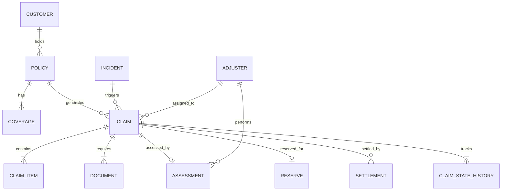

# Insurance Claims Processing — Data Dictionary

## Overview

This document describes every entity in the insurance claims data model, its
fields, relationships, cardinality, lifecycle states and validation rules.

### Data type and unit conventions

- All monetary values ending in `_amount`, `_limit`, `_premium`, `_deductible`,
  `_reserve`, or `_cost` are decimal **USD** amounts unless a row has an explicit
  `currency` field. Values are rounded to two decimal places.
- Percentages are expressed as percentage points (for example `20` means 20%).
- Quantities, witness counts, file sizes (`file_size_kb`), term months and
  concurrency limits are non-negative counts; `file_size_kb` is measured in KB.
- `DATE` values use ISO `YYYY-MM-DD`; `TIMESTAMP` values use ISO date and time.
- Fields with no finite allowed-value set accept descriptive text, subject to
  the type, requiredness and relationship constraints in the field table.
- Nullability is indicated by a blank in the Required column. IDs are unique
  within their entity table; foreign keys must resolve to the referenced table.

---

## Entity-Relationship Summary



| Relationship | Cardinality | Notes |
|---|---|---|
| Customer → Policy | 1:N | One customer may hold many policies |
| Policy → Coverage | 1:N | Each policy has 2–4 coverage lines |
| Policy → Claim | 1:N | A policy may generate multiple claims |
| Incident → Claim | 1:N | One incident can spawn one or more claims |
| Claim → ClaimItem | 1:N | Each claim has 1–5 line items |
| Claim → Document | 1:N | Each claim requires 3–4 documents |
| Customer → Document | 1:N | `uploaded_by` references the submitting customer |
| Claim → Assessment | 1:1 | One assessment per reviewed claim |
| Claim → Reserve | 1:1 | One reserve per non-denied claim |
| Claim → Settlement | 1:N | Usually 1:1; N allows edge cases (paid twice) |
| Assessment → Settlement | 1:N, optional | Settlement references its recommendation when available |
| Adjuster → Reserve | 1:N | `set_by` identifies the adjuster establishing the reserve |
| Adjuster → Settlement | 1:N | `approved_by` identifies the approving adjuster |
| Customer → Settlement | 1:N, optional | `payee_customer_id` identifies the payee when applicable |
| Claim → ClaimStateHistory | 1:N | Immutable event log |
| Adjuster → Claim | 1:N | Adjuster handles many claims |
| Adjuster → Assessment | 1:N | Adjuster performs many assessments |

The current model has no many-to-many relationship: its represented links are
one-to-many or optional one-to-one, so a bridge table is not needed. The
operational app records reassignment actions in the append-only event log.

---

## 1. Customer

| Field | Type | Required | Unique | Allowed Values / Validation |
|---|---|---|---|---|
| `customer_id` | VARCHAR(15) | ✓ PK | ✓ | `CUST-NNNNNN` |
| `first_name` | VARCHAR(50) | ✓ | | |
| `last_name` | VARCHAR(50) | ✓ | | |
| `date_of_birth` | DATE | ✓ | | `YYYY-MM-DD`, 1950-01-01 to 2000-12-31 |
| `email` | VARCHAR(100) | ✓ | | Valid email format |
| `phone` | VARCHAR(20) | ✓ | | `(NNN) NNN-NNNN` |
| `address_line1` | VARCHAR(200) | ✓ | | |
| `city` | VARCHAR(50) | ✓ | | |
| `state` | CHAR(2) | ✓ | | US state abbreviation |
| `zip_code` | CHAR(5) | ✓ | | 5 digits |
| `created_at` | TIMESTAMP | ✓ | | |
| `status` | VARCHAR(10) | ✓ | | `ACTIVE`, `INACTIVE` |

---

## 2. Policy

| Field | Type | Required | Unique | Allowed Values / Validation |
|---|---|---|---|---|
| `policy_id` | VARCHAR(30) | ✓ PK | ✓ | `POL-<PRODUCT>-2026-NNNNNN` |
| `customer_id` | VARCHAR(15) | ✓ FK | | → Customer |
| `product_type` | VARCHAR(10) | ✓ | | `AUTO`, `HOME`, `HEALTH`, `LIFE`, `TRAVEL` |
| `policy_number` | VARCHAR(30) | ✓ | ✓ | Same as policy_id |
| `effective_date` | DATE | ✓ | | < expiration_date |
| `expiration_date` | DATE | ✓ | | > effective_date |
| `term_months` | INT | ✓ | | 6, 12, 24, 36 |
| `premium_amount` | DECIMAL(12,2) | ✓ | | > 0 |
| `payment_frequency` | VARCHAR(15) | ✓ | | `MONTHLY`, `QUARTERLY`, `SEMI_ANNUAL`, `ANNUAL` |
| `status` | VARCHAR(12) | ✓ | | `ACTIVE`, `EXPIRED`, `CANCELLED`, `LAPSED` |
| `cancellation_date` | DATE | | | Required when status = CANCELLED |
| `lapse_date` | DATE | | | Required when status = LAPSED |
| `underwriting_status` | VARCHAR(15) | ✓ | | `APPROVED`, `CONDITIONAL`, `DECLINED` |
| `created_at` | TIMESTAMP | ✓ | | |
| `updated_at` | TIMESTAMP | ✓ | | |

**Lifecycle:** `ACTIVE` → `EXPIRED` (term ends) / `CANCELLED` (early termination) / `LAPSED` (non-payment)

---

## 3. Coverage

| Field | Type | Required | Unique | Allowed Values / Validation |
|---|---|---|---|---|
| `coverage_id` | VARCHAR(40) | ✓ PK | ✓ | `COV-<policy_id>-NNN` |
| `policy_id` | VARCHAR(30) | ✓ FK | | → Policy |
| `coverage_type` | VARCHAR(30) | ✓ | | Product-specific (see COVERAGE_CONFIG) |
| `coverage_limit` | DECIMAL(12,2) | ✓ | | Product-specific range |
| `deductible` | DECIMAL(12,2) | ✓ | | ≥ 0 |
| `co_pay_percentage` | INT | ✓ | | 0, 10, 20, 30 (HEALTH only) |
| `exclusions` | TEXT | | | Comma-separated list |
| `effective_date` | DATE | ✓ | | = policy effective_date |
| `expiration_date` | DATE | ✓ | | = policy expiration_date |
| `status` | VARCHAR(10) | ✓ | | `ACTIVE`, `INACTIVE` |

---

## 4. Incident

| Field | Type | Required | Unique | Allowed Values / Validation |
|---|---|---|---|---|
| `incident_id` | VARCHAR(20) | ✓ PK | ✓ | `INC-2026-NNNNNN` |
| `incident_type` | VARCHAR(35) | ✓ | | Product-specific (see INCIDENT_TYPES) |
| `incident_date` | DATE | ✓ | | |
| `incident_time` | TIME | ✓ | | `HH:MM:SS` |
| `description` | TEXT | ✓ | | |
| `location_city` | VARCHAR(50) | ✓ | | |
| `location_state` | CHAR(2) | ✓ | | US state abbreviation |
| `severity` | VARCHAR(10) | ✓ | | `LOW`, `MEDIUM`, `HIGH`, `CRITICAL` |
| `police_report_filed` | BOOLEAN | ✓ | | |
| `witnesses` | INT | ✓ | | 0–5 |
| `product_category` | VARCHAR(10) | ✓ | | `AUTO`, `HOME`, `HEALTH`, `LIFE`, `TRAVEL` |
| `reported_date` | DATE | ✓ | | ≥ incident_date |

---

## 5. Claim

| Field | Type | Required | Unique | Allowed Values / Validation |
|---|---|---|---|---|
| `claim_id` | VARCHAR(20) | ✓ PK | ✓ | `CLM-2026-NNNNNN` |
| `policy_id` | VARCHAR(30) | ✓ FK | | → Policy |
| `customer_id` | VARCHAR(15) | ✓ FK | | → Customer |
| `incident_id` | VARCHAR(20) | ✓ FK | | → Incident |
| `claim_type` | VARCHAR(10) | ✓ | | `AUTO`, `HOME`, `HEALTH`, `LIFE`, `TRAVEL` |
| `claim_amount` | DECIMAL(12,2) | ✓ | | > 0 |
| `submission_date` | DATE | ✓ | | ≥ incident reported_date |
| `status` | VARCHAR(20) | ✓ | | See lifecycle below |
| `assigned_adjuster_id` | VARCHAR(15) | ✓ FK | | → Adjuster |
| `priority` | VARCHAR(10) | ✓ | | `LOW`, `MEDIUM`, `HIGH`, `URGENT` |
| `denial_reason` | VARCHAR(50) | | | Required when status = DENIED |
| `fraud_indicator` | BOOLEAN | ✓ | | |
| `coverage_id` | VARCHAR(40) | FK | | → Coverage (nullable) |
| `created_at` | TIMESTAMP | ✓ | | |
| `updated_at` | TIMESTAMP | ✓ | | ≥ created_at |

**Lifecycle:**
```
SUBMITTED → UNDER_REVIEW → APPROVED → SETTLED → CLOSED
                 ↓              ↓
         PENDING_DOCUMENTS   DENIED
                 ↓
           UNDER_REVIEW
```

---

## 6. ClaimItem

| Field | Type | Required | Unique | Allowed Values / Validation |
|---|---|---|---|---|
| `claim_item_id` | VARCHAR(30) | ✓ PK | ✓ | `CLI-<claim_id>-NNN` |
| `claim_id` | VARCHAR(20) | ✓ FK | | → Claim |
| `item_description` | TEXT | ✓ | | |
| `item_category` | VARCHAR(10) | ✓ | | Matches claim_type |
| `claimed_amount` | DECIMAL(12,2) | ✓ | | > 0 |
| `approved_amount` | DECIMAL(12,2) | | | Set when claim approved; ≤ claimed_amount |
| `quantity` | INT | ✓ | | 1–3 |
| `unit_cost` | DECIMAL(12,2) | ✓ | | > 0 |
| `status` | VARCHAR(10) | ✓ | | `PENDING`, `APPROVED`, `DENIED` |

---

## 7. Document

| Field | Type | Required | Unique | Allowed Values / Validation |
|---|---|---|---|---|
| `document_id` | VARCHAR(30) | ✓ PK | ✓ | `DOC-<claim_id>-NNN` |
| `claim_id` | VARCHAR(20) | ✓ FK | | → Claim |
| `document_type` | VARCHAR(30) | ✓ | | Product-specific required docs |
| `file_name` | VARCHAR(100) | ✓ | | |
| `file_size_kb` | INT | ✓ | | 50–5000 |
| `upload_date` | DATE | ✓ | | ≥ claim submission_date |
| `uploaded_by` | VARCHAR(15) | ✓ FK | | → Customer |
| `status` | VARCHAR(10) | ✓ | | `RECEIVED`, `VERIFIED`, `REJECTED` |
| `verification_date` | DATE | | | Set after review |
| `notes` | TEXT | | | |

---

## 8. Adjuster

| Field | Type | Required | Unique | Allowed Values / Validation |
|---|---|---|---|---|
| `adjuster_id` | VARCHAR(15) | ✓ PK | ✓ | `ADJ-NNNNNN` |
| `first_name` | VARCHAR(50) | ✓ | | |
| `last_name` | VARCHAR(50) | ✓ | | |
| `email` | VARCHAR(100) | ✓ | | Valid email format |
| `phone` | VARCHAR(20) | ✓ | | |
| `specializations` | TEXT | ✓ | | Comma-separated product types |
| `license_number` | VARCHAR(20) | ✓ | ✓ | `ADJ-LIC-NNNNNN` |
| `hire_date` | DATE | ✓ | | |
| `status` | VARCHAR(10) | ✓ | | `ACTIVE`, `ON_LEAVE`, `INACTIVE` |
| `max_concurrent_claims` | INT | ✓ | | 10, 15, 20, 25 |

---

## 9. Assessment

| Field | Type | Required | Unique | Allowed Values / Validation |
|---|---|---|---|---|
| `assessment_id` | VARCHAR(30) | ✓ PK | ✓ | `ASN-<claim_id>-NNN` |
| `claim_id` | VARCHAR(20) | ✓ FK | | → Claim |
| `adjuster_id` | VARCHAR(15) | ✓ FK | | → Adjuster |
| `assessment_date` | DATE | ✓ | | > claim submission_date |
| `assessed_amount` | DECIMAL(12,2) | ✓ | | 70–100% of claim_amount |
| `deductible_applied` | DECIMAL(12,2) | ✓ | | From coverage |
| `eligible_amount` | DECIMAL(12,2) | ✓ | | `min(assessed - deductible, limit)` |
| `coverage_limit` | DECIMAL(12,2) | ✓ | | From coverage |
| `coverage_verified` | BOOLEAN | ✓ | | |
| `liability_percentage` | INT | ✓ | | 0, 25, 50, 75, 100 |
| `recommendation` | VARCHAR(10) | ✓ | | `APPROVE`, `DENY`, `REVIEW` |
| `notes` | TEXT | | | |
| `fraud_score` | DECIMAL(5,3) | ✓ | | 0.000–1.000; ≥0.5 for fraud_indicator=True |

---

## 10. Reserve

| Field | Type | Required | Unique | Allowed Values / Validation |
|---|---|---|---|---|
| `reserve_id` | VARCHAR(30) | ✓ PK | ✓ | `RSV-<claim_id>-NNN` |
| `claim_id` | VARCHAR(20) | ✓ FK | | → Claim |
| `initial_reserve` | DECIMAL(12,2) | ✓ | | 80–120% of claim_amount |
| `current_reserve` | DECIMAL(12,2) | ✓ | | Initially = initial_reserve |
| `reserve_type` | VARCHAR(10) | ✓ | | `CASE` |
| `set_date` | DATE | ✓ | | > claim submission_date |
| `last_updated` | DATE | ✓ | | ≥ set_date |
| `set_by` | VARCHAR(15) | ✓ FK | | → Adjuster |
| `currency` | CHAR(3) | ✓ | | `USD` |
| `status` | VARCHAR(10) | ✓ | | `OPEN`, `CLOSED` |

---

## 11. Settlement

| Field | Type | Required | Unique | Allowed Values / Validation |
|---|---|---|---|---|
| `settlement_id` | VARCHAR(30) | ✓ PK | ✓ | `SET-<claim_id>-NNN` |
| `claim_id` | VARCHAR(20) | ✓ FK | | → Claim |
| `assessment_id` | VARCHAR(30) | FK | | → Assessment (nullable) |
| `settlement_amount` | DECIMAL(12,2) | ✓ | | From assessment eligible_amount |
| `payment_method` | VARCHAR(20) | ✓ | | `CHECK`, `ACH`, `WIRE_TRANSFER`, `DIRECT_DEPOSIT` |
| `payment_date` | DATE | ✓ | | > approved_date |
| `approved_by` | VARCHAR(15) | ✓ FK | | → Adjuster |
| `approved_date` | DATE | ✓ | | |
| `status` | VARCHAR(10) | ✓ | | `PENDING`, `APPROVED`, `PAID`, `REJECTED` |
| `payee_name` | VARCHAR(100) | ✓ | | Derived from customer |
| `payee_customer_id` | VARCHAR(15) | ✓ FK | | → Customer |
| `notes` | TEXT | | | |

---

## 12. ClaimStateHistory (Event Log)

| Field | Type | Required | Unique | Allowed Values / Validation |
|---|---|---|---|---|
| `event_id` | VARCHAR(30) | ✓ PK | ✓ | `EVT-<claim_id>-NNN` |
| `claim_id` | VARCHAR(20) | ✓ FK | | → Claim |
| `from_status` | VARCHAR(20) | | | Previous state (NULL for first) |
| `to_status` | VARCHAR(20) | ✓ | | Valid claim state |
| `changed_by` | VARCHAR(15) | ✓ | | Adjuster ID or `SYSTEM` |
| `change_reason` | TEXT | ✓ | | |
| `event_timestamp` | TIMESTAMP | ✓ | | Monotonically increasing per claim |

---

## Edge Cases / Ground Truth Labels

| Issue Type | Entity | Expected Decision | Severity |
|---|---|---|---|
| `CLAIM_DATE_BEFORE_POLICY_START` | CLAIM | DENY | HIGH |
| `POLICY_CANCELLED_BEFORE_INCIDENT` | CLAIM | DENY | HIGH |
| `DUPLICATE_INCIDENT` | INCIDENT | FLAG_DUPLICATE | MEDIUM |
| `SETTLEMENT_EXCEEDS_LIMIT` | SETTLEMENT | CAP_TO_LIMIT | HIGH |
| `MISSING_MANDATORY_DOCUMENT` | CLAIM | REQUEST_DOCUMENTS | MEDIUM |
| `CLAIM_PAID_TWICE` | SETTLEMENT | FLAG_DUPLICATE_PAYMENT | CRITICAL |

---

## ID Convention Summary

| Entity | Pattern | Example |
|---|---|---|
| Customer | `CUST-NNNNNN` | `CUST-000042` |
| Policy | `POL-<PRODUCT>-2026-NNNNNN` | `POL-AUTO-2026-000001` |
| Coverage | `COV-<policy_id>-NNN` | `COV-POL-AUTO-2026-000001-001` |
| Claim | `CLM-2026-NNNNNN` | `CLM-2026-000100` |
| ClaimItem | `CLI-<claim_id>-NNN` | `CLI-CLM-2026-000100-001` |
| Document | `DOC-<claim_id>-NNN` | `DOC-CLM-2026-000100-001` |
| Incident | `INC-2026-NNNNNN` | `INC-2026-000050` |
| Adjuster | `ADJ-NNNNNN` | `ADJ-000010` |
| Assessment | `ASN-<claim_id>-NNN` | `ASN-CLM-2026-000100-001` |
| Reserve | `RSV-<claim_id>-NNN` | `RSV-CLM-2026-000100-001` |
| Settlement | `SET-<claim_id>-NNN` | `SET-CLM-2026-000100-001` |
